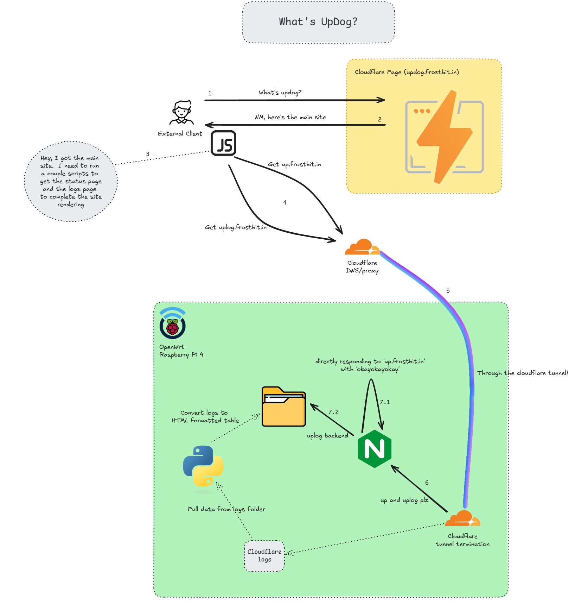

**How to Create a Cloudflare Tunnel-Based Internet Status Checker** 

This guide walks through the steps of creating a web page that displays your internet connection status, using Cloudflare Tunnels, OpenWrt, and a Cloudflare Page.


https://updog.frostbit.in

https://misc.frostbit.in/updog.mp3

**Lore**

I see a post every month on my neighborhood's Facebook group asking if anyone else's internet is down.  I wanted to create a 'simple' way to check my internet status and share it with my neighbors.

Why set it up this way?  My main reason is that I wanted a way to check my internet status from anywhere without relying on a third-party uptime service or putting this on a server behind the router.  If the server goes down, I can't check the status.  This way, the status page is served directly from the router.  Also thrid party services limit the number of checks you can do in a minute.  This way, I can check as many times as I want.

PLUS, you get to tell people about "UpDog".  

- "What's UpDog?"  
- "Well I'm glad you asked.  It's my internet status page.  You can check it out at updog.frostbit.in."  
- "What's updog.frostbit.in?"
- "Not much, what's up with you?"
- "I hate you."
- "I know."


**Overview** 



This guide may have some missing steps or incorrect information.  I had created this a while ago and ended up dumping all my info into ChatGPT to create the documentation for me.  This is going to be more of a concept guide than a full step by step guide.  I'll try to fill in the blanks as I go.

You’ll set up:

1. A Cloudflare Tunnel to expose your OpenWrt router services.

2. A Cloudflare Page to create a public status page.

3. Nginx on OpenWrt to serve responses for status checks and logs.


**Main Components**
- `https://up.frostbit.in/test`: Responds with `okayokayokay` for simple status checks.
- `https://uplog.frostbit.in`: Serves the outage history, built from the logs of the cloudflare tunnel installed on OpenWrt.
- `https://updog.frostbit.in`: Public status page showing internet status and logs.

---

**Prerequisites**  
- OpenWrt router with `nginx`, `python3` and `cloudflared` installed.
 
- A domain name managed by Cloudflare (e.g., `frostbit.in`).

- Basic knowledge of Linux, DNS, and web servers.


**Some values in this doc to look out for and replace**
- `frostbit.in`: Your domain name.
- `10.10.101.1`: Your OpenWrt router IP.
- `updog-frostbit`: Your Cloudflare Page name.
- `Matt Frost`: Your name.
- `US/Eastern`: Your timezone.

---

**Setup Instructions** **1. OpenWrt Configuration** **Install Necessary Packages** 

Ensure the following are installed on your OpenWrt router:

- `cloudflared` (version ~ 2024.4.1-2)
 
- `nginx` (version ~ 1.25.0-4)

- `python3` (version ~ 3.11.7-1)

- `python3-pip`, then `pip3 install pytz` (version ~ 2024.1)

These are installed using the `opkg` package manager.


**Set Up Nginx**


Copy [`router/nginx.conf`](router/nginx.conf) to `/etc/nginx/nginx.conf`. It has two server blocks:

- `8888`: Responds with `okayokayokay` for status checks.
- `8889`: Serves logs from `/www/logs/`.

Access-Control-Allow-Origin headers are set to allow requests from the Cloudflare Pages.

Both blocks also send a `Cache-Control` header with `max-age=0`, so browsers always check again, and an `s-maxage`, so Cloudflare answers most requests without bothering the router.


Restart Nginx on OpenWrt:

```bash
/etc/init.d/nginx restart
```


**Generate the Outage History Page** 

[`router/log-to-html.py`](router/log-to-html.py) reads the Cloudflare logs from `/var/log/cloudflared.log` and generates an HTML file in `/www/logs/index.html`.

`cloudflared` keeps 4 connections to Cloudflare, and they drop and reconnect on their own all the time. One connection dropping doesn't mean the internet is down, so the script only counts an outage when all 4 are gone. Each row shows when the outage started and how long it lasted, and the top of the page shows the overall uptime.
 
- Save the script as `/root/log-to-html.py`.

- Add a cron job to update the logs every 5 minutes.

```bash
crontab -e
```

Add the following line:


```bash
*/5 * * * *  /usr/bin/python /root/log-to-html.py
```

The tests are in [`router/test_log_to_html.py`](router/test_log_to_html.py). They need `pytz`, and you can run them from the `router` folder with `python -m unittest test_log_to_html`.

**2. Cloudflare Tunnel Setup** **Create the Tunnel**  

1. Install `cloudflared` on your OpenWrt router.
 
2. Authenticate your Cloudflare account:


```bash
cloudflared login
```
 
3. Create a new tunnel named `home-router`:

```bash
cloudflared tunnel create home-router
```
 
4. Add the following configuration to `/etc/cloudflared/config.yml`:


```yaml
tunnel: 92b3e10f-2565-4440-8f2c-7cedf3dd1b7f
credentials-file: /root/.cloudflared/92b3e10f.json

ingress:
  - hostname: up.frostbit.in
    service: http://10.10.101.1:8888
  - hostname: uplog.frostbit.in
    service: http://10.10.101.1:8889
  - service: http_status:404
```
 
5. Run the tunnel:


```bash
cloudflared tunnel run home-router
```

You can also manage the ingress rules from the Zero Trust dashboard instead of `config.yml`, which is how mine is set up now. To keep the tunnel running after a reboot, enable the OpenWrt `cloudflared` service in `/etc/config/cloudflared` rather than running it by hand.

**Set Up DNS** 

In your Cloudflare DNS settings:
 
- Add a CNAME record for `up.frostbit.in` pointing to your tunnel’s `UUID.cfargotunnel.com`.
 
- Add a CNAME record for `uplog.frostbit.in` pointing to the same tunnel.


---

**3. Cloudflare Page** **The Status Page** The page for `updog.frostbit.in` is [`page/index.html`](page/index.html).

It checks `https://up.frostbit.in/test` once when the page loads. The check uses `cache: 'no-store'` so the browser can't answer from its own cache.

**Deploy the Page** 
1. Go to Cloudflare Workers & Pages.
 
2. Create a new Page named `updog-frostbit`.
 
3. Deploy the `page` folder (via Upload Assets, or `wrangler pages deploy page --project-name updog-frostbit --branch main`) and bind the page to `updog.frostbit.in`.

**Set Up Caching** 

This part matters. The zone's default Browser Cache TTL overrides what nginx sends, and with the default of 4 hours, a visitor's browser can keep showing "internet is up" during an outage.

In Caching > Cache Rules, add a rule for `up.frostbit.in`, `uplog.frostbit.in` and `updog.frostbit.in`:

- **Cache eligibility:** eligible for cache
- **Edge TTL:** use the cache-control header
- **Browser TTL:** respect origin


---

**4. Testing** **Verify Each Endpoint**  
- `https://up.frostbit.in/test` → Should return `okayokayokay`.
 
- `https://uplog.frostbit.in` → Should show the HTML logs.
 
- `https://updog.frostbit.in` → Should display internet status and embed logs.
- `curl -sI https://up.frostbit.in/test` → `Cache-Control` should show `max-age=0`. If it shows `max-age=14400`, the cache rule isn't applying.

**Test a Real Outage** 

Run `/etc/init.d/cloudflared stop` on the router, wait about a minute and reload the status page. It should turn red. Then run `/etc/init.d/cloudflared start`. This adds a row to the outage history until the next reboot clears the log.


**Debugging Tips**  
- Check `cloudflared` logs for tunnel issues.
- Check Nginx logs for server issues.
- Check Zero Trust logs for tunnel connection status and issues.
- Use browser developer tools to debug fetch requests from the page.
- Check to make sure the python script is running and updating /www/logs/index.html.


---

**Caveats**

- The status can stay green for up to 30 seconds after an outage starts, because Cloudflare caches it that long to protect the router.  Lower `s-maxage` in `nginx.conf` if you want it tighter.
- If too many people are checking the status page, you could kill your openwrt router.  I'm not sure how many people it can handle, but I'm guessing not many.  Maybe I'll find out O_O.
- If the router power cycles, the tunnel logs will be cleared.  “C'est la vie”.
- If the router is on but the tunnel is down, the logs will not be up to date until the tunnel comes back up.
- The logs will update every 5 mins, so the internet may be back up before the logs are updated on the status page.
- If you update the tunnel version, check the to make sure the tunnel comes back up after the update.  There's one time I had a bad version and the tunnel wouldn't come back up.
- No you don't get notifications if the internet goes down.  We're not that fancy here.
- Is there a better way to do this?  Probably.
- Should you be installing all these packages and assigning all these extra functions to a poor little Raspberry Pi 4 that's already running a critical service for your home network?  Probably not.  But here we are.

---

This guide should now provide almost all the information needed for others to replicate your setup!