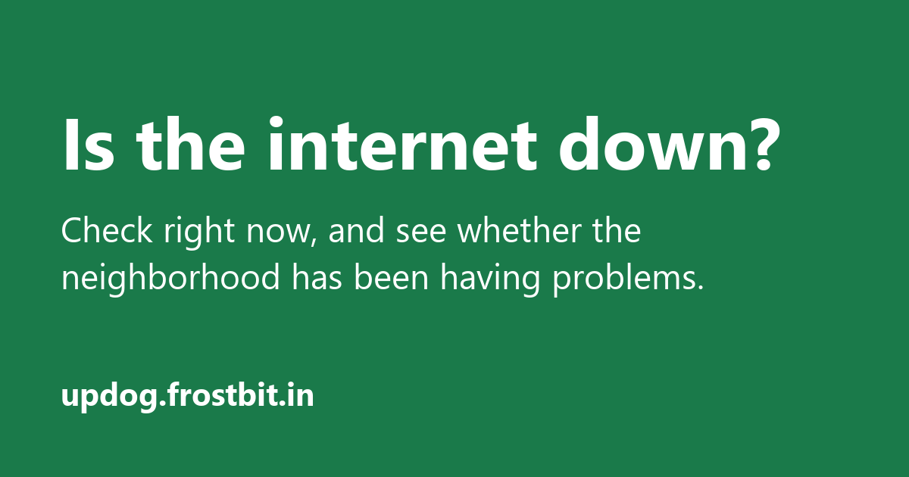
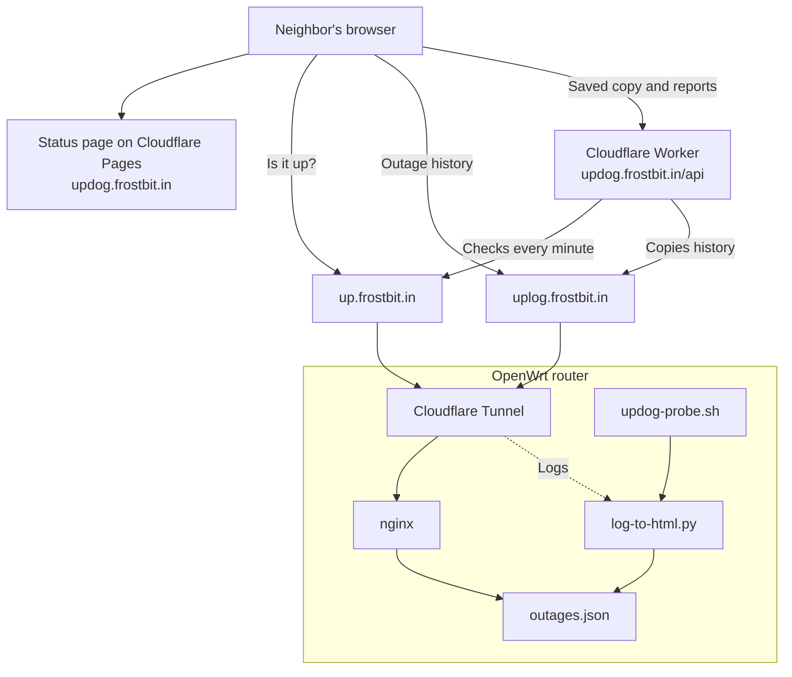
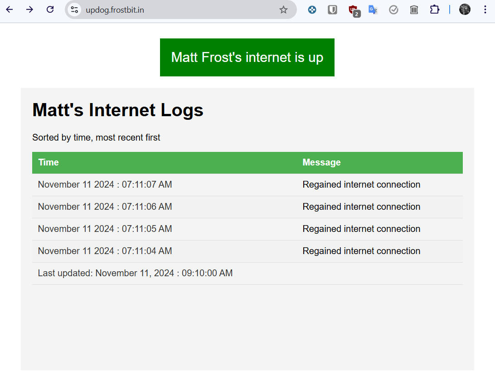

# UpDog 2.0

[](https://github.com/milagrofrost/updog/actions/workflows/test.yml)

A status page that answers the question my neighbors keep asking: is the internet down? It runs on an OpenWrt router and Cloudflare's free tier.



https://updog.frostbit.in

https://misc.frostbit.in/updog.mp3

## Lore

I see a post every month on my neighborhood's Facebook group asking if anyone else's internet is down.  I wanted to create a 'simple' way to check my internet status and share it with my neighbors.

Why set it up this way?  My main reason is that I wanted a way to check my internet status from anywhere without relying on a third-party uptime service or putting this on a server behind the router.  If the server goes down, I can't check the status.  This way, the status check is answered directly by the router.  Also third party services limit the number of checks you can do in a minute.  This way, I can check as many times as I want.

PLUS, you get to tell people about "UpDog".

- "What's UpDog?"
- "Well I'm glad you asked.  It's my internet status page.  You can check it out at updog.frostbit.in."
- "What's updog.frostbit.in?"
- "Not much, what's up with you?"
- "I hate you."
- "I know."

## What's new in 2.0

| | 1.0 | 2.0 |
|---|---|---|
| **The page** | A banner and a log table | "Is the internet down?" with a big answer, stats and a 90-day chart |
| **Outages** | Every dropped tunnel connection, about 500 "outages" in 7 months | Only when all 4 connections are gone, about 30 in the same time |
| **Whose fault** | No idea | Sorted into ISP, not the ISP, or unclear |
| **During an outage** | A cached green banner for up to 4 hours, and no history | Red within about 30 seconds, with how long it's been down and a saved history |
| **Neighbors** | Could only look | Can tap "Mine's down", so people can see it's not just them |
| **After a reboot** | History gone | History kept |

## How it works



| Piece | Where it runs | What it does |
|---|---|---|
| [`page/`](page/) | Cloudflare Pages | The status page |
| [`router/nginx.conf`](router/nginx.conf) | Router | Answers `okayokayokay` on `up.frostbit.in/test`, and serves the history on `uplog.frostbit.in` |
| [`router/log-to-html.py`](router/log-to-html.py) | Router, from cron | Works out the outages from the tunnel log and the probe log |
| [`router/updog-probe.sh`](router/updog-probe.sh) | Router, always on | Records the state of the link, modem, gateway and internet |
| [`worker/`](worker/) | Cloudflare Workers | Checks the router from outside, keeps a copy of the history, and counts reports |
| [`deploy.sh`](deploy.sh) | Your PC | Updates the router from this repo |

Here's how it all started, back in 1.0:




### What counts as an outage

`cloudflared` keeps 4 connections to Cloudflare, and they drop and reconnect on their own all the time. One dropping doesn't mean the internet is down, so an outage only counts when all 4 are gone.

The tunnel can take a few minutes to notice, so the start time comes from the probe when it saw trouble first.

### Whose fault it was

- **ISP:** the modem answered, but the internet didn't.
- **Not the ISP:** the router rebooted or lost power, the USB adapter disconnected, the tunnel was restarted, or the internet was fine for an outage of at least 60 seconds.
- **Unclear:** the link to the modem dropped (that could be the modem, the cable or the ISP), the modem stopped responding, the outage was too short to tell, the probe wasn't running, or it happened before the probe was installed.

The probe checks the link, route and modem every second, and network events from `netifd` wake it straight away. It pings the gateway and internet every 15 seconds, or right after an event. It only writes when something changes, plus an hourly heartbeat that proves it's still running and a small file every 5 minutes for spotting reboots and power loss.

## What you need

- An OpenWrt router you can SSH into
- A domain managed by Cloudflare
- Basic knowledge of Linux, DNS and web servers

Replace these with your own:

| Value | Where |
|---|---|
| `frostbit.in` | `page/index.html`, `router/nginx.conf`, `worker/wrangler.toml` |
| `updog-frostbit`, the Cloudflare Pages project | Your deploy command |
| `Matt` and the Spectrum outage link | `page/index.html` |
| `Matt's` and `US/Eastern` | `router/log-to-html.py` |
| `eth1` and `192.168.100.1`, your WAN and modem | Top of `router/updog-probe.sh` |

## Setup

### 1. Install the packages

```bash
opkg install nginx-ssl python3 python3-pip
pip3 install pytz
```

Install `cloudflared` too. The OpenWrt package can be well behind, so check its version against [Cloudflare's releases](https://github.com/cloudflare/cloudflared/releases), where you can also download the binary directly.

### 2. Create the tunnel

```bash
cloudflared login
cloudflared tunnel create home-router
```

Put this in `/etc/cloudflared/config.yml`:

```yaml
tunnel: <your-tunnel-id>
credentials-file: /etc/cloudflared/<your-tunnel-id>.json

ingress:
  - hostname: up.frostbit.in
    service: http://127.0.0.1:8888
  - hostname: uplog.frostbit.in
    service: http://127.0.0.1:8889
  - service: http_status:404
```

You can manage those ingress rules from the Zero Trust dashboard instead, which is how mine is set up.

UpDog reads the tunnel's log, so turn the service and its log on in `/etc/config/cloudflared`:

```
config cloudflared 'config'
	option enabled '1'
	option loglevel 'info'
	option logfile '/var/log/cloudflared.log'
```

```bash
/etc/init.d/cloudflared enable
/etc/init.d/cloudflared restart
```

Then add a CNAME for both `up.frostbit.in` and `uplog.frostbit.in` in Cloudflare DNS, pointing to `<your-tunnel-id>.cfargotunnel.com`.

Once it's working, you can move `cert.pem` off the router. It's a credential for your whole Cloudflare account, and it's only needed to create or delete tunnels.

### 3. Install UpDog on the router

Run this from your PC:

```bash
ROUTER=root@192.168.1.1 ./deploy.sh deploy
```

Then add this cron job on the router:

```bash
*/5 * * * * /usr/bin/python3 /root/log-to-html.py
```

### 4. Deploy the status page

Create a Cloudflare Pages project, then deploy the `page` folder and bind it to `updog.frostbit.in`:

```bash
wrangler pages deploy page --project-name updog-frostbit --branch main
```

### 5. Set up caching

**This part matters.** The zone's default Browser Cache TTL overrides what nginx sends, and with the default of 4 hours, a visitor's browser can keep showing "internet is up" during an outage.

In Caching > Cache Rules, add a rule for `up.frostbit.in`, `uplog.frostbit.in` and `updog.frostbit.in`:

- **Cache eligibility:** eligible for cache
- **Edge TTL:** use the cache-control header
- **Browser TTL:** respect origin

Then add a URL rewrite Transform Rule for just `up.frostbit.in` and `uplog.frostbit.in` that clears the query string. Otherwise `?anything` skips the edge cache and reaches your router.

### 6. Deploy the Worker

This is what keeps the page useful while your house is offline. It all fits in Cloudflare's free tier.

```bash
cd worker
wrangler d1 create updog            # put the ID it prints in wrangler.toml
wrangler d1 execute updog --remote --file=schema.sql
wrangler secret put REPORT_SALT     # any long random string
wrangler deploy
```

It runs at `updog.frostbit.in/api/*`, on the same hostname as the page. If you protect your domain with Cloudflare Access, add a bypass for `up`, `uplog` and `updog`, or your neighbors will get a login page.

Reports never store an address. Each one is a hash of the address, the date and that secret, which is enough to count a household once per hour and nothing else.

### 7. Get told when it's down

In Notifications, add a Tunnel Health alert for when the tunnel goes down. Skip the degraded status, because single connections drop all the time.

### 8. Share it

[`share/`](share/) has a QR code for the neighborhood post, and `page/preview.png` is the image shown when the link gets shared.

## Check that it works

- `https://up.frostbit.in/test` returns `okayokayokay`.
- `https://uplog.frostbit.in` shows the outage history.
- `https://uplog.frostbit.in/outages.json` returns the outage data.
- `https://updog.frostbit.in/api/status` returns the Worker's view.
- `https://updog.frostbit.in` shows the status and recent outages.
- `curl -sI https://up.frostbit.in/test` shows `max-age=0` in `Cache-Control`. If it shows `max-age=14400`, the cache rule isn't applying.

Then test a real outage. Run `/etc/init.d/cloudflared stop` on the router, wait about a minute and reload the status page. It should turn red and show the saved history. Then run `/etc/init.d/cloudflared start`.

This adds a row under "Problems on Matt's end", and finished outages are saved. To remove it, delete it from `/root/updog/history.json`.

## Updating the router

```bash
ROUTER=root@192.168.1.1 ./deploy.sh status
ROUTER=root@192.168.1.1 ./deploy.sh deploy
```

`status` compares the router with this repo, and warns if the cron job or `pytz` is missing. `deploy` checks each new file on the router before changing anything, including running the outage script against copies of your real logs. If any file fails, nothing changes. Otherwise it installs the changed files, saves the old ones with a `.prev` extension, and restarts only the services affected.

It doesn't install packages, set up the cron job or configure the tunnel. The status page and Worker deploy with `wrangler` instead.

## Tests

They run on every change through GitHub Actions. To run them yourself:

```bash
cd router && python -m unittest test_log_to_html    # needs pytz
cd worker && node --test
```

## Debugging

- Check `/var/log/cloudflared.log` for tunnel issues.
- Check `/var/log/nginx/` for server issues.
- Check `/root/updog/probe.log` to see what the probe recorded.
- Check that `/www/logs/outages.json` is updating every 5 minutes.
- Use your browser's developer tools to debug the requests from the page.

## Caveats

- The status can stay green for up to 30 seconds after an outage starts, because Cloudflare caches it that long to protect the router.  Lower `s-maxage` in `nginx.conf` if you want it tighter.
- During an outage, the history is the last saved copy, so it won't include the current outage.
- The history updates every 5 mins, so the internet may be back up before the outage shows up on the page.
- If the router power cycles, the tunnel logs are cleared, but finished outages are saved.  The start of the outage can be up to 5 minutes off, since that's how often the heartbeat is saved.
- If the probe was down during an outage, that outage shows as unclear rather than guessing.  It can only tell to within about an hour, since that's how often the heartbeat is logged.
- Older outages stay unclear. If you have a `/root/wan-monitor.log` from the old `wan-modem-monitor` script, it's read for outages from that time, but it never checked the internet, so it can't clear the ISP.
- It only shows what one house's connection saw, so another street could have a different story.
- Anyone with the link can tap "Mine's down", so treat the count as a hint.  We're still not that fancy here.
- If too many people check the status page, you could kill your openwrt router.  Cloudflare answers most of those requests now, so probably not.  Maybe I'll find out O_O.
- If you update the tunnel version, make sure the tunnel comes back up after the update.  There's one time I had a bad version and the tunnel wouldn't come back up.
- Is there a better way to do this?  Probably.
- Should you be installing all these packages and assigning all these extra functions to a poor little Raspberry Pi 4 that's already running a critical service for your home network?  Probably not.  But here we are.
