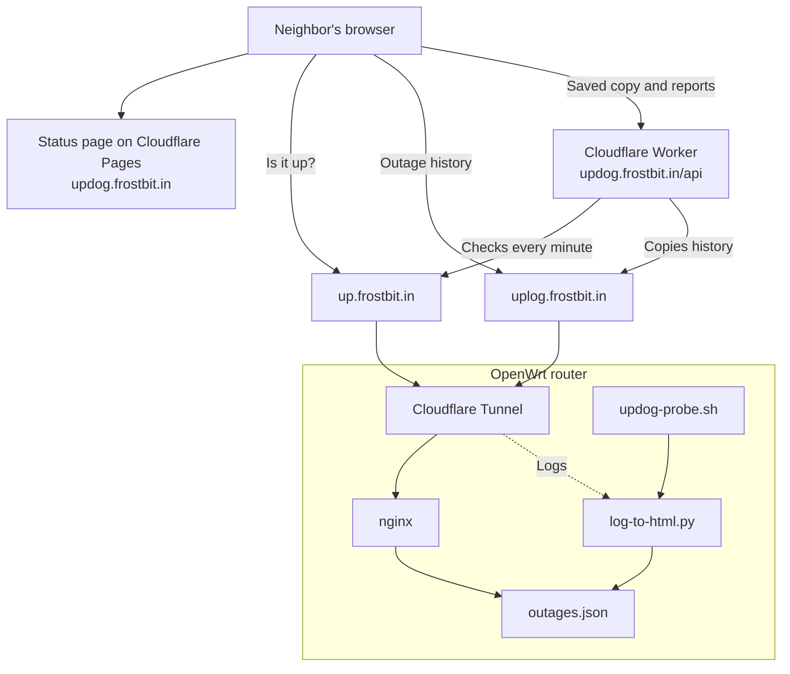

**How to Create a Cloudflare Tunnel-Based Internet Status Checker** 

[](https://github.com/milagrofrost/updog/actions/workflows/test.yml)

This guide walks through the steps of creating a web page that displays your internet connection status, using Cloudflare Tunnels, OpenWrt, and a Cloudflare Page.


https://updog.frostbit.in

https://misc.frostbit.in/updog.mp3

**Lore**

I see a post every month on my neighborhood's Facebook group asking if anyone else's internet is down.  I wanted to create a 'simple' way to check my internet status and share it with my neighbors.

Why set it up this way?  My main reason is that I wanted a way to check my internet status from anywhere without relying on a third-party uptime service or putting this on a server behind the router.  If the server goes down, I can't check the status.  This way, the status page is served directly from the router.  Also thrid party services limit the number of checks you can do in a minute.  This way, I can check as many times as I want.

PLUS, you get to tell people about "UpDog".  

- "What's UpDog?"  
- "Well I'm glad you asked.  It's my internet status page.  You can check it out at updog.frostbit.in."  
- "What's updog.frostbit.in?"
- "Not much, what's up with you?"
- "I hate you."
- "I know."


**Overview** 


This guide may have some missing steps or incorrect information.  I had created this a while ago and ended up dumping all my info into ChatGPT to create the documentation for me.  This is going to be more of a concept guide than a full step by step guide.  I'll try to fill in the blanks as I go.

That drawing is how UpDog started. It has grown a little since then:



You’ll set up:

1. A Cloudflare Tunnel to expose your OpenWrt router services.

2. A Cloudflare Page to create a public status page.

3. Nginx on OpenWrt to serve responses for status checks and logs.


**Main Components**
- `https://up.frostbit.in/test`: Responds with `okayokayokay` for simple status checks.
- `https://uplog.frostbit.in`: Serves the outage history, as a plain page and as `outages.json` for the status page.
- `https://updog.frostbit.in`: Public status page answering "is the internet down?" and showing recent outages for the neighbors.

---

**Prerequisites**  
- OpenWrt router with `nginx`, `python3` and `cloudflared` installed.
 
- A domain name managed by Cloudflare (e.g., `frostbit.in`).

- Basic knowledge of Linux, DNS, and web servers.


**Some values in this doc to look out for and replace**
- `frostbit.in`: Your domain name.
- `updog-frostbit`: Your Cloudflare Page name.
- `Matt Frost`: Your name.
- `US/Eastern`: Your timezone.

---

**Setup Instructions** **1. OpenWrt Configuration** **Install Necessary Packages** 

Ensure the following are installed on your OpenWrt router:

- `cloudflared` (version ~ 2024.4.1-2)
 
- `nginx` (version ~ 1.25.0-4)

- `python3` (version ~ 3.11.7-1)

- `python3-pip`, then `pip3 install pytz` (version ~ 2024.1)

These are installed using the `opkg` package manager.


**Set Up Nginx**


Copy [`router/nginx.conf`](router/nginx.conf) to `/etc/nginx/nginx.conf`. It has two server blocks, which only listen on localhost because only the tunnel needs them. If you're changing the addresses on a running router, use `restart` rather than `reload`:

- `8888`: Responds with `okayokayokay` for status checks.
- `8889`: Serves logs from `/www/logs/`.

Access-Control-Allow-Origin headers are set to allow requests from the Cloudflare Pages.

Both blocks also send a `Cache-Control` header with `max-age=0`, so browsers always check again, and an `s-maxage`, so Cloudflare answers most requests without bothering the router.


Restart Nginx on OpenWrt:

```bash
/etc/init.d/nginx restart
```


**Generate the Outage History Page** 

[`router/log-to-html.py`](router/log-to-html.py) reads the Cloudflare logs from `/var/log/cloudflared.log` and generates an HTML file in `/www/logs/index.html`.

`cloudflared` keeps 4 connections to Cloudflare, and they drop and reconnect on their own all the time. One connection dropping doesn't mean the internet is down, so the script only counts an outage when all 4 are gone. Each row shows when the outage started and how long it lasted. It also writes `/www/logs/outages.json`, which is what the status page reads, and saves finished outages to `/root/updog/history.json` so they survive a reboot.
 
- Save the script as `/root/log-to-html.py`.

- Add a cron job to update the logs every 5 minutes.

```bash
crontab -e
```

Add the following line:


```bash
*/5 * * * *  /usr/bin/python /root/log-to-html.py
```

The tests are in [`router/test_log_to_html.py`](router/test_log_to_html.py). They need `pytz`, and you can run them from the `router` folder with `python -m unittest test_log_to_html`.

**Sort Outages by Cause** 

[`router/updog-probe.sh`](router/updog-probe.sh) runs all the time and records the link to the modem, the modem, the public IP and route, the ISP's gateway and the internet. The local checks run every second, and network events from `netifd` wake it straight away. The gateway and internet checks run every 15 seconds, or right after an event, because a ping can't be event driven. It only writes when something changes, plus an hourly heartbeat that proves it's still running and a small file every 5 minutes for spotting reboots and power loss.

The tunnel can take a few minutes to notice the connection has gone, so the script uses this to work out when an outage really started, as well as to sort it:

- **ISP:** the modem answered, but the internet didn't.
- **Not the ISP:** the router rebooted or lost power, the USB adapter disconnected, the tunnel was restarted, or the internet was fine for an outage of at least 60 seconds.
- **Unclear:** the link to the modem dropped (that could be the modem, the cable or the ISP), the modem stopped responding, the outage was too short to tell, the probe wasn't running, or it happened before the probe was installed.

The probe assumes your WAN is `eth1` and your modem answers at `192.168.100.1`. Change those at the top of the script if yours are different.

This used to be a separate script called `wan-modem-monitor`, which logged to `/root/wan-monitor.log` and never checked the internet. If that log exists, the script still reads it for older outages. It can rule out the link and modem for those, but it can't clear the ISP.

```bash
cp router/updog-probe.sh /root/updog-probe.sh
cp router/updog-probe.init /etc/init.d/updog-probe
chmod +x /root/updog-probe.sh /etc/init.d/updog-probe
/etc/init.d/updog-probe enable
/etc/init.d/updog-probe start
```

**2. Cloudflare Tunnel Setup** **Create the Tunnel**  

1. Install `cloudflared` on your OpenWrt router.
 
2. Authenticate your Cloudflare account:


```bash
cloudflared login
```
 
3. Create a new tunnel named `home-router`:

```bash
cloudflared tunnel create home-router
```
 
4. Add the following configuration to `/etc/cloudflared/config.yml`:


```yaml
tunnel: <your-tunnel-id>
credentials-file: /etc/cloudflared/<your-tunnel-id>.json

ingress:
  - hostname: up.frostbit.in
    service: http://127.0.0.1:8888
  - hostname: uplog.frostbit.in
    service: http://127.0.0.1:8889
  - service: http_status:404
```
 
5. Run the tunnel:


```bash
cloudflared tunnel run home-router
```

You can also manage the ingress rules from the Zero Trust dashboard instead of `config.yml`, which is how mine is set up now. To keep the tunnel running after a reboot, enable the OpenWrt `cloudflared` service in `/etc/config/cloudflared` rather than running it by hand.

**Set Up DNS** 

In your Cloudflare DNS settings:
 
- Add a CNAME record for `up.frostbit.in` pointing to your tunnel’s `UUID.cfargotunnel.com`.
 
- Add a CNAME record for `uplog.frostbit.in` pointing to the same tunnel.


---

**3. Cloudflare Page** **The Status Page** The page for `updog.frostbit.in` is [`page/index.html`](page/index.html).

It answers the two things neighbors actually ask:

- **Is it down right now?** It checks `https://up.frostbit.in/test` when the page loads and every minute after that. The check uses `cache: 'no-store'` so the browser can't answer from its own cache, and it tries twice so one slow request doesn't show red.
- **Has it been happening to anyone else?** It reads `https://uplog.frostbit.in/outages.json` and shows quick stats, a 90-day chart and the recent outages. Blips under a minute and problems on your end are folded away.

**Deploy the Page** 
1. Go to Cloudflare Workers & Pages.
 
2. Create a new Page named `updog-frostbit`.
 
3. Deploy the `page` folder (via Upload Assets, or `wrangler pages deploy page --project-name updog-frostbit --branch main`) and bind the page to `updog.frostbit.in`.

**Set Up Caching** 

This part matters. The zone's default Browser Cache TTL overrides what nginx sends, and with the default of 4 hours, a visitor's browser can keep showing "internet is up" during an outage.

In Caching > Cache Rules, add a rule for `up.frostbit.in`, `uplog.frostbit.in` and `updog.frostbit.in`:

- **Cache eligibility:** eligible for cache
- **Edge TTL:** use the cache-control header
- **Browser TTL:** respect origin


---

**Keep It Working During an Outage** 

The history lives on the router, so on its own it can't load during an outage. [`worker/`](worker/) is a small Cloudflare Worker that doesn't need your house to be online. It checks the router every minute, keeps a copy of the outage history, and counts "mine's down" reports from neighbors. It all fits in Cloudflare's free tier. It runs at `updog.frostbit.in/api/*`, on the same hostname as the page, so it stays public even if you protect the rest of the domain with Cloudflare Access.

```bash
cd worker
wrangler d1 create updog            # put the ID it prints in wrangler.toml
wrangler d1 execute updog --remote --file=schema.sql
wrangler secret put REPORT_SALT     # any long random string
wrangler deploy
```

Reports never store an address. Each one is a hash of the address, the date and that secret, which is enough to count a household once per hour and nothing else. The Worker's tests run with `node --test` from the `worker` folder.

**Stop the Cache Being Skipped** 

Add a URL rewrite Transform Rule for `up.frostbit.in` and `uplog.frostbit.in` that clears the query string (just `up` and `uplog`, not the page). Otherwise `?anything` skips the edge cache and reaches your router.

**Get Told When It's Down** 

In Notifications, add a Tunnel Health alert for when the tunnel goes down. Skip the degraded status, because single connections drop all the time.

**Share It** 

[`share/`](share/) has a QR code for the neighborhood post, and `page/preview.png` is the image shown when the link gets shared.

---

**Back Up the Router**

[`router/updog-backup.sh`](router/updog-backup.sh) runs from cron, encrypts the router's config and pushes it to a private git repo. No other machine needs to be on. It leaves out large binaries you can download again, so each backup is tiny.

It uses `age` with a public key, so the router can encrypt but can't read its own backups. Keep the private key somewhere safe and away from the router, because without it the backups are useless.

```bash
opkg install git                    # and put the age binary in /usr/bin
age-keygen -o backup-key.txt        # on your PC, not the router
dropbearkey -t ed25519 -f /root/.ssh/updog-backup-key
```

Add that key's public half to the private repo as a deploy key with write access, and add `github.com`'s host key to `/root/.ssh/known_hosts`. Then create `/root/updog/backup.conf`:

```sh
BACKUP_REPO=git@github.com:you/router-backup.git
BACKUP_RECIPIENT=age1...your-public-key
BACKUP_SSH_KEY=/root/.ssh/updog-backup-key
```

Then add the cron job. It runs three times a day but skips if there's been a backup in the last 20 hours, so a failure at night gets retried:

```bash
30 8,14,20 * * * /root/updog-backup.sh
```

To also keep an unencrypted copy on an NFS share, install `nfs-utils`, `kmod-fs-nfs` and `kmod-fs-nfs-v3`, create the folder on the share, and add this to `backup.conf`:

```sh
BACKUP_NFS_SHARE=server:/share
BACKUP_NFS_DIR=router-backups
BACKUP_NFS_OWNER=1000:1000
```

The router mounts the share only while it copies the backup, and keeps one file per day. If the share is unavailable, it logs a warning and the encrypted backup still goes out. That copy includes your tunnel credentials and SSH keys in the clear, so think about who else can reach the share.

`deploy.sh status` warns if the last backup or copy is over 2 days old. Test a restore once it's running, because a backup you can't restore is no backup at all.

**Updating the Router**


[`deploy.sh`](deploy.sh) compares the router with the repo and updates anything that's different. It only needs SSH access.

```bash
ROUTER=root@192.168.1.1 ./deploy.sh status
ROUTER=root@192.168.1.1 ./deploy.sh deploy
```

It checks each new file on the router before changing anything, including running the outage script against copies of your real logs. If any file fails, nothing changes. Otherwise it installs the changed files, saves the old ones with a `.prev` extension, and restarts only the services affected. The status page and Worker deploy with `wrangler` instead.

It doesn't install packages, set up the cron job or configure the tunnel, so do those by hand the first time. It warns you if the cron job or `pytz` is missing.

---

**4. Testing** **Verify Each Endpoint**  
- `https://up.frostbit.in/test` → Should return `okayokayokay`.
 
- `https://uplog.frostbit.in` → Should show the HTML logs.
 
- `https://uplog.frostbit.in/outages.json` → Should return the outage data.
 
- `https://updog.frostbit.in` → Should display internet status and recent outages.
- `curl -sI https://up.frostbit.in/test` → `Cache-Control` should show `max-age=0`. If it shows `max-age=14400`, the cache rule isn't applying.

**Test a Real Outage** 

Run `/etc/init.d/cloudflared stop` on the router, wait about a minute and reload the status page. It should turn red. Then run `/etc/init.d/cloudflared start`. This adds a row under "Problems on Matt's end". To remove it, delete it from `/root/updog/history.json`.


**Debugging Tips**  
- Check `cloudflared` logs for tunnel issues.
- Check Nginx logs for server issues.
- Check Zero Trust logs for tunnel connection status and issues.
- Use browser developer tools to debug fetch requests from the page.
- Check to make sure the python script is running and updating /www/logs/index.html.


---

**Caveats**

- The status can stay green for up to 30 seconds after an outage starts, because Cloudflare caches it that long to protect the router.  Lower `s-maxage` in `nginx.conf` if you want it tighter.
- If too many people are checking the status page, you could kill your openwrt router.  I'm not sure how many people it can handle, but I'm guessing not many.  Maybe I'll find out O_O.
- If the router power cycles, the tunnel logs will be cleared, but finished outages are saved.  The start of the outage can be up to 5 minutes off, since that's how often the heartbeat is saved.
- The outage history lives on the router, so it can't load while the internet is down.  “C'est la vie”.
- If the probe was down during an outage, that outage shows as unclear rather than guessing.  It can only tell to within about an hour, since that's how often the heartbeat is logged.
- If the router is on but the tunnel is down, the logs will not be up to date until the tunnel comes back up.
- The logs will update every 5 mins, so the internet may be back up before the logs are updated on the status page.
- If you update the tunnel version, check the to make sure the tunnel comes back up after the update.  There's one time I had a bad version and the tunnel wouldn't come back up.
- Anyone with the link can tap "Mine's down", so treat the count as a hint.  We're still not that fancy here.
- Is there a better way to do this?  Probably.
- Should you be installing all these packages and assigning all these extra functions to a poor little Raspberry Pi 4 that's already running a critical service for your home network?  Probably not.  But here we are.

---

This guide should now provide almost all the information needed for others to replicate your setup!